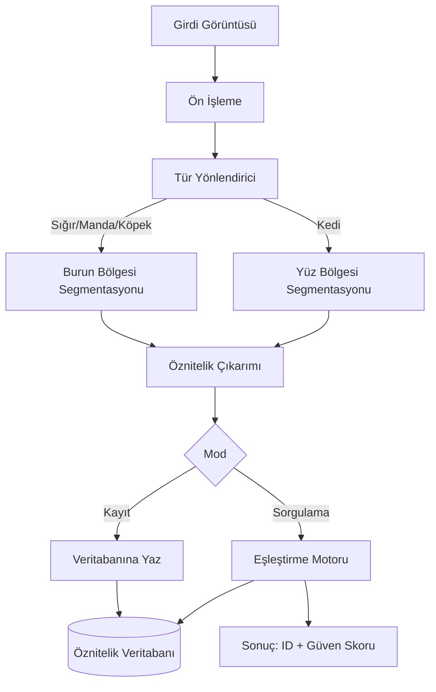

# Sistem Mimarisi Dokümanı
## ZooID (MABIS) — Çoklu Tür Hayvan Biyometrik Kimlik Tespit Sistemi

**İlişkili doküman:** PRD.md
**Versiyon:** 0.1 (taslak)

---

## 1. Genel Mimari Bakışı

Sistem iki ana akıştan oluşur: **Kayıt (Registration)** ve **Sorgulama
(Query/Identification)**. Her iki akış da aynı ön işleme → segmentasyon →
öznitelik çıkarımı hattını paylaşır, yalnızca son adımda ayrışır (biri
veritabanına yazar, diğeri veritabanıyla karşılaştırır).



## 2. Modüller

### 2.1 Görüntü Alma (Image Acquisition)
- **Girdi:** Ham fotoğraf dosyası (jpg/png) veya veri seti yükleyicisi
  (dataset loader)
- **Çıktı:** Standart formatta (BGR/RGB, bilinen boyut aralığında) bellek içi
  görüntü nesnesi
- **Sorumluluk:** Dosya okuma, format doğrulama, çözünürlük/EXIF kontrolü

### 2.2 Ön İşleme (Preprocessing)
- **Girdi:** Ham görüntü
- **Çıktı:** Normalize edilmiş, gürültüsü azaltılmış, kontrastı iyileştirilmiş
  görüntü
- **İşlemler:** Gri seviye/HSV dönüşümü, CLAHE (kontrast iyileştirme), medyan
  filtre (gürültü giderme), boyut normalize etme

### 2.3 Tür Yönlendirici (Species Router)
- **Girdi:** Ön işlenmiş görüntü + tür etiketi (kullanıcı seçimi veya
  meta veri)
- **Çıktı:** İlgili segmentasyon dalına yönlendirme kararı
- **Not (MVP basitleştirmesi):** Tür otomatik tespiti kapsam dışıdır;
  kullanıcı/veri seti etiketi üzerinden yönlendirme yapılır

### 2.4 ROI Segmentasyonu (Bölge Segmentasyonu)
İki alt modül, türe göre ayrılır:

| Alt modül | Türler | Yöntem |
|---|---|---|
| Burun Segmentasyonu | Sığır/Manda, Köpek | Eşikleme + kenar tespiti veya Haar cascade ile burun bölgesi bulma, morfolojik temizleme |
| Yüz Segmentasyonu | Kedi | Yüz/kafa bölgesi tespiti (Haar cascade veya kontur tabanlı), göz-burun hizalama |

- **Çıktı:** Sabit boyuta kırpılmış (ör. 300×300) ROI görüntüsü

### 2.5 Öznitelik Çıkarımı (Feature Extraction)
- **Girdi:** ROI görüntüsü
- **Çıktı:** Sabit uzunlukta öznitelik vektörü
- **Yöntemler (karşılaştırmalı denenecek):** LBP (doku), GLCM (doku
  istatistikleri), SIFT/ORB (anahtar nokta tabanlı)
- **Not:** Hangi yöntemin/kombinasyonun kullanılacağı Hafta 3'teki
  deneylerle netleşecek; modül arayüzü yöntemden bağımsız tasarlanmalı
  (bkz. Bölüm 5)

### 2.6 Öznitelik Veritabanı (Feature Database)
- **Kayıt yapısı:** `{animal_id, species, feature_vector, metadata}`
- **MVP için:** Basit dosya tabanlı çözüm (JSON/pickle) veya SQLite yeterli
  — dağıtık/ölçekli bir veritabanı gerekmiyor
- **metadata:** kayıt tarihi, kaynak veri seti, tür alt bilgisi (ırk vb.)

### 2.7 Eşleştirme Motoru (Matching Engine)
- **Girdi:** Sorgu öznitelik vektörü + veritabanındaki tüm kayıtlar
- **Çıktı:** En yakın eşleşme(ler) + güven skoru
- **Yöntem:** KNN (k-en yakın komşu) veya kosinüs benzerliği — kesin seçim
  Hafta 4'teki ilk uçtan uca testte karşılaştırılacak

### 2.8 Değerlendirme Modülü (Evaluation)
- **Girdi:** Test seti tahminleri + gerçek etiketler
- **Çıktı:** Rank-1 doğruluk, precision/recall/F1, confusion matrix,
  (opsiyonel) ROC/EER
- **Not:** Bu modül üretim hattının parçası değildir, yalnızca
  deney/rapor amaçlıdır

### 2.9 Arayüz (Interface) — opsiyonel, düşük öncelik
- MVP için basit bir CLI (komut satırı) yeterli: `register  <id>`,
  `identify `
- Zaman kalırsa basit bir Streamlit/Gradio arayüzü eklenebilir (demo için)

## 3. Veri Akışı Özeti

**Kayıt akışı:**
`Görüntü → Ön İşleme → Segmentasyon → Öznitelik Çıkarımı → Veritabanına Yaz`

**Sorgulama akışı:**
`Görüntü → Ön İşleme → Segmentasyon → Öznitelik Çıkarımı → Eşleştirme → Sonuç`

**Değerlendirme akışı:**
`Test Seti → (Sorgulama akışı her örnek için) → Tahminler → Metrik Hesaplama`

## 4. Teknoloji Eşlemesi

| Modül | Kütüphane |
|---|---|
| Görüntü Alma | OpenCV (`cv2.imread`), Pillow |
| Ön İşleme | OpenCV (`cvtColor`, `createCLAHE`, `medianBlur`) |
| Segmentasyon | OpenCV (eşikleme, kontur, Haar cascade) |
| Öznitelik Çıkarımı | scikit-image (`local_binary_pattern`, `greycomatrix`), OpenCV (`SIFT_create`, `ORB_create`) |
| Veritabanı | Python `sqlite3` veya `pickle`/`json` |
| Eşleştirme | scikit-learn (`NearestNeighbors`), `scipy.spatial.distance.cosine` |
| Değerlendirme | scikit-learn (`classification_report`, `confusion_matrix`, `roc_curve`) |
| Görselleştirme (rapor için) | matplotlib, seaborn |

## 5. Modül Arayüz Sözleşmesi (taslak)

> Not: Bu bölüm, ayrı bir "Modül Arayüz Tanımı" dokümanında detaylandırılacak;
> burada AI destekli IDE'nin kod yazarken tutarlı kalması için asgari
> imzalar veriliyor.

```python
def preprocess(image: np.ndarray) -> np.ndarray: ...

def segment_roi(image: np.ndarray, species: str) -> np.ndarray: ...

def extract_features(roi: np.ndarray, method: str = "lbp") -> np.ndarray: ...

def register(animal_id: str, species: str, feature_vector: np.ndarray) -> None: ...

def identify(feature_vector: np.ndarray, species: str, k: int = 1) -> list[tuple[str, float]]: ...

def evaluate(predictions: list, ground_truth: list) -> dict: ...
```

## 6. Önerilen Klasör Yapısı

```
zooid/
├── data/
│   ├── raw/                # indirilen ham veri setleri (tür bazlı alt klasörler)
│   └── processed/          # segmente edilmiş ROI görüntüleri
├── src/
│   ├── preprocessing/
│   ├── segmentation/
│   ├── features/
│   ├── matching/
│   ├── database/
│   └── evaluation/
├── notebooks/               # deneysel/keşif amaçlı notebook'lar
├── tests/                   # birim testleri
├── results/                 # makale için şekil/tablo çıktıları
├── main.py                  # CLI giriş noktası
└── requirements.txt
```

## 7. Tasarım Kararları ve Gerekçeleri

- **Tür yönlendirmesi manuel/etiket tabanlı tutuldu** — otomatik tür
  sınıflandırması ek karmaşıklık katar ve projenin asıl odağı (biyometrik
  tanıma) değil; 8 haftalık süre için kapsam dışı bırakıldı.
- **Dosya tabanlı veritabanı tercih edildi** — MVP ölçeğinde (birkaç yüz
  kayıt) SQLite/JSON performans sorunu yaratmaz, kurulum karmaşıklığından
  kaçınılır.
- **Öznitelik çıkarımı yöntemden bağımsız arayüzle tasarlandı** — LBP/GLCM/
  SIFT arasında deneysel karşılaştırma yapılacağı için modülün değişmesi
  diğer bileşenleri etkilememeli.

## 8. Sonraki Doküman

Bir sonraki adım: **Veri Seti & Ön İşleme Notu** — veri setlerinin klasör/
format standardı, train/test ayrımı ve temizleme adımlarının detaylandığı
doküman.
